# Pavo 多显示器壁纸技术方案

> 版本：v1.3（2026-11-14 第四轮评审修订）
> 状态：已评审定稿
> 前置分析：见本文档第 1.1 节与附录 B（方案自审记录）

## 目录

1. [背景与目标](#1-背景与目标)
2. [总体架构](#2-总体架构)
3. [平台层设计](#3-平台层设计)
4. [数据与配置设计](#4-数据与配置设计)
5. [接口设计](#5-接口设计)
6. [核心流程与时序图](#6-核心流程与时序图)
7. [前端设计](#7-前端设计)
8. [轮播线程改造](#8-轮播线程改造)
9. [分阶段实施计划](#9-分阶段实施计划)
10. [测试与验收](#10-测试与验收)
11. [附录](#11-附录)

---

## 1. 背景与目标

### 1.1 现状与问题

Pavo 当前设置壁纸的底层调用是第三方 crate `wallpaper` v3.2.0。经源码核实，其各平台实现均不支持逐屏设置：

| 平台 | 现有实现 | 问题 |
|------|---------|------|
| Windows | `SystemParametersInfoW(SPI_SETDESKWALLPAPER)` + 写注册表 `WallpaperStyle` 后重放 | 旧式 API，全局语义；模式设置依赖"改注册表→重设一遍"的 hack；与 Win8+ 逐屏机制（`IDesktopWallpaper`）脱节 |
| macOS | 起 `osascript` 子进程，`tell every desktop to set picture` | 每次设置 spawn 子进程（慢）；走 System Events 依赖 AppleScript 权限链路（TCC），跨版本脆弱；错误信息为 AppleScript 字符串 |
| Linux | 各 DE 命令行（gsettings 等） | 全局语义；GNOME 无逐屏 API |

全项目对 crate 的调用面**只有一处两行**（`src-tauri/src/services/bing.rs:146,149`），上游 4 个入口全部汇聚到 `set_wallpaper_from_local`，替换成本低。

CI（`.github/workflows/release.yml`）实际构建并发布 **macOS（双架构）/ Windows / Linux** 三平台产物，其中 Linux 无人工验收，属"随 crate 顺带工作"的状态。

### 1.2 目标

1. 支持多显示器环境下**为每个屏幕单独设置壁纸**；
2. 以行为保持的底层重构（Phase 0）替换非标准的 `wallpaper` crate 调用（Windows/macOS），建立平台层地基；
3. 自动轮播支持统一模式（所有屏幕同步）与逐屏独立模式；
4. Linux 保持现有全局行为不回归；
5. 所有设置入口（手动、托盘、轮播、每日更新）共享同一套平台层与缓存逻辑。

### 1.3 非目标

- 不支持 Windows 7（Tauri v2 依赖 WebView2，实际部署环境为 Win10/11，`IDesktopWallpaper` 自 Win8 起可用）；
- 不支持 GNOME/Wayland 逐屏（上游无 API，统一回落全局）；
- 不做每屏独立的轮播间隔（逐屏模式共用全局间隔与同一图片列表）；
- 不扩展 Bing 之外的图片来源服务；
- 不做壁纸重启恢复——操作系统自身持久化每屏壁纸，应用不重复存储。

### 1.4 关键决策记录

| # | 决策 | 结论 | 理由 |
|---|------|------|------|
| D1 | Linux 支持去留 | **保留** `wallpaper` crate，降级为 Linux-only 依赖 | CI 实际发布 Linux 产物；手写各 DE 命令属重复劳动；放弃支持需产品拍板且与 README 矛盾 |
| D2 | 逐屏设置的 UI 形态 | **卡片菜单展开**（设为桌面 → 所有屏幕 / 各屏幕项） | 复用现有 `shared/ui/menu` 组件与 `⋯` 菜单范式；改动小于独立屏幕管理器 |
| D3 | 轮播逐屏行为 | Phase 3 提供 `wallpaper_mode` 开关，逐屏独立推进 | 统一模式与现行为一致作为默认；逐屏为显式选择 |
| D4 | 每屏壁纸状态存储 | **不持久化**，运行时从操作系统反查 | OS 已持久化每屏壁纸（`GetWallpaper` / `desktopImageURLForScreen`）；持久化会造成双份状态与同步 bug；配置只新增 `wallpaper_mode` 一个字段 |
| D5 | Phase 0 独立发版 | 重构先行、单独验收 | 与"逐屏功能"解耦，出问题可明确归因；符合项目既有的分阶段验收流程 |

---

## 2. 总体架构

### 2.1 分层架构图

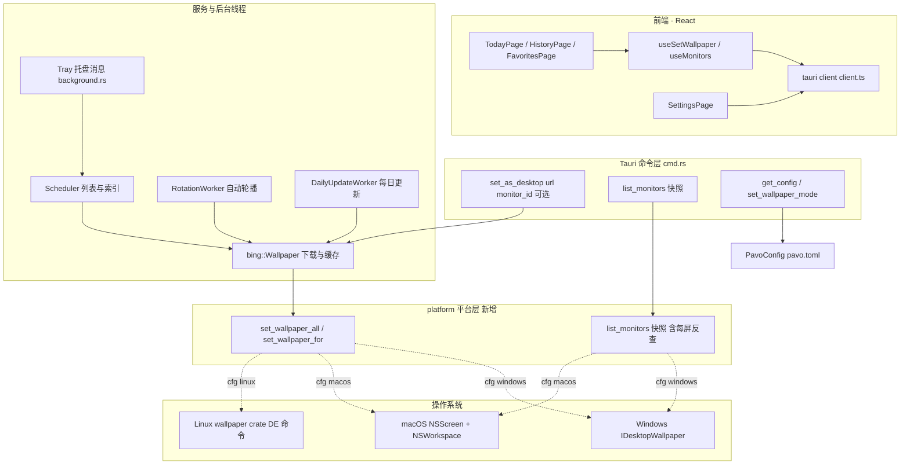

> 注：Phase 0 仅包含 `P1`（全屏设置路径）；`P2` 与 `C2/C3` 属 Phase 1。

### 2.2 模块职责

| 模块 | 职责 | 状态 |
|------|------|------|
| `platform.rs`（新增） | 全屏/逐屏设置壁纸、屏幕枚举快照；`#[cfg]` 平台分支 | 新增 |
| `services/bing.rs` | 下载缓存（`save_wallpaper`）+ 调用 platform 设置（Phase 0）；`clean_cache` 增加引用保护（Phase 1，见 4.2） | 修改 |
| `cmd.rs` | 命令参数扩展（`monitor_id`）、新命令注册 | 修改 |
| `config.rs` | 新增 `wallpaper_mode` 字段与容错解析 | 修改 |
| `rotation_thread.rs` | 按模式分支：统一 / 逐屏推进 | 修改 |
| `events.rs` | `WallpaperEvent` 增加屏幕标识字段 | 修改 |
| `scheduler.rs` | 托盘上/下一张入口；承载逐屏推进共享函数；事件发射带屏幕参数 | 小改 |
| 前端 `useSetWallpaper` / `useMonitors` / 三页菜单 / 设置页 | 交互与反馈 | 修改 |

### 2.3 平台能力矩阵

| 能力 | Windows | macOS | Linux |
|------|---------|-------|-------|
| 屏幕枚举 | `IDesktopWallpaper::GetMonitorDevicePathAt/Count` | `NSScreen.screens` | 不提供（快照能力位 `per_monitor=false`） |
| 逐屏设置 | `SetWallpaper(monitorID, path)` | `NSWorkspace.setDesktopImageURL(_:forScreen:)` | 不支持，命令返回错误 |
| 全屏设置 | `SetWallpaper(NULL, path)` | 遍历 NSScreen 逐屏设置 | crate 全局命令 |
| 查询每屏当前壁纸 | `GetWallpaper(monitorID)` | `NSWorkspace.desktopImageURLForScreen` | 不支持 |
| 填充模式 | `SetPosition(FILL)`（全局） | 选项 `NSWorkspaceDesktopImageScalingKey` | crate 自行处理 |
| 屏幕标识 | 设备路径（运行时） | CGDisplayID（运行时） | — |

> 标识不持久化（决策 D4）：所有定向均基于实时枚举、会话内回传，无跨重启匹配需求。

### 2.4 分阶段演进

| 阶段 | 内容 | 交付物 |
|------|------|--------|
| Phase 0 | 行为保持的平台层替换 | `platform.rs`（全屏路径）+ crate 降级为 Linux-only |
| Phase 1 | 屏幕枚举 + 逐屏定向 + 事件 v2 | `list_monitors` 快照、`set_as_desktop(monitor_id)` |
| Phase 2 | 前端逐屏交互 | 三页菜单、设置页屏幕分组、hook 改造 |
| Phase 3 | 轮播逐屏独立 | `wallpaper_mode` 配置 + 设置页开关 + 轮播分支 |

---

## 3. 平台层设计

### 3.1 模块结构与接口

Phase 0 采用**单文件 + `#[cfg]` 分支**（避免预支目录结构），Phase 1 若枚举逻辑使其超过约 400 行再拆分为 `platform/` 目录。

```rust
// src-tauri/src/platform.rs（骨架）

/// 屏幕描述。id 为运行时标识（本次枚举产生，前端会话内回传；不持久化）。
/// current_filename 为 OS 反查的当前壁纸文件名。
#[derive(Debug, Clone, Serialize)]
pub struct MonitorInfo {
  pub id: String,
  pub name: String,
  pub index: usize,
  pub width: u32,
  pub height: u32,
  pub is_primary: bool,
  pub current_filename: Option<String>,
}

/// 枚举快照：能力位 + 屏幕列表，单次 IPC 同时返回。
/// per_monitor 为 false 时（Linux），逐屏命令返回错误。
#[derive(Debug, Clone, Serialize)]
pub struct MonitorSnapshot {
  pub per_monitor: bool,
  pub monitors: Vec<MonitorInfo>,
}

pub type PlatformResult<T> = Result<T, String>;

/// 所有屏幕设为同一张图。Phase 0 交付。
pub fn set_wallpaper_all(path: &str) -> PlatformResult<()>;

/// 指定屏幕设置壁纸。Phase 1 交付；Linux 直接返回 Err。
pub fn set_wallpaper_for(monitor_id: &str, path: &str) -> PlatformResult<()>;

/// 枚举显示器并反查每屏当前壁纸。Phase 1 交付。
pub fn list_monitors() -> PlatformResult<MonitorSnapshot>;
```

约定：

- 错误统一为 `String`，前缀标注平台与语义（如 `"[win] monitor not found: {id}"`），经 `log::error!` 记录后向上透传到命令层 → 前端 toast；
- 所有阻塞系统调用在 `tokio::task::spawn_blocking` 中执行（沿用 `set_wallpaper_from_local` 现有模式）；
- 涉及 Windows COM / macOS 主线程的部分见下文各平台小节。

### 3.2 Windows 实现（IDesktopWallpaper）

接口坐标：CLSID `{C2CF3110-460E-4FC1-B9D0-8411A9D4F7AA}`，IID `{B92B56A9-8B38-411B-9C34-8090763C2E30}`，通过 `windows` crate（features：`Win32_UI_Shell`、`Win32_System_Com`、`Win32_Graphics_Gdi`）调用。

**关键实现点：**

1. **COM 初始化**：每次调用线程需 `CoInitializeEx`。当前代码路径是 `spawn_blocking` 每次新线程，稳妥写法：

   ```rust
   unsafe {
     match CoInitializeEx(None, COINIT_APARTMENTTHREADED) {
       Ok(()) => {}
       Err(e) if e == RPC_E_CHANGED_MODE => {} // 线程已是 MTA，继续
       Err(e) => return Err(format!("[win] CoInitializeEx failed: {e}")),
     }
   }
   // 结束时 CoUninitialize()（仅在本次初始化成功时）
   ```

2. **全屏设置**：`SetWallpaper(NULL, path)`——微软文档规定 monitorID 为 NULL 时作用于所有显示器，无需自行循环（若实测个别系统 NULL 语义异常，退化为显式枚举后循环调用，逻辑等价）；
3. **逐屏设置**：`SetWallpaper(monitor_id, path)`；
4. **填充模式**：`SetPosition(DESKTOP_WALLPAPER_POSITION_FILL)`。该调用是全局语义（一次作用于全部屏幕），与现有 `set_mode(Crop)` 的全局语义一致，各屏共用填充规则、仅图片不同；
5. **屏幕枚举**：`GetMonitorDevicePathCount` + `GetMonitorDevicePathAt(i)` 得到 id（形如 `DISPLAY#厂商型号#实例段#接口GUID` 的设备路径）；
6. **主屏判定**：`GetMonitorRECT(id)` 原点为 `(0,0)` 的即主屏（虚拟屏幕坐标系约定）；
7. **友好名称**：`EnumDisplayDevicesW` 对该设备路径二次枚举取 monitor 层的 `DeviceString`（EDID 名称）；取不到时回落为 `"显示器 {index+1}"`；
8. **每屏当前壁纸**：`GetWallpaper(id)` 返回本地路径 → 提取文件名；
9. **与旧路径互斥**：引入 IDesktopWallpaper 后**不得再调用** `SystemParametersInfoW`——SPI 是全局语义，会破坏逐屏状态。因此 crate 的 Windows 路径整体退场（Phase 0 即完成）；
10. **Windows 幻灯片**：不主动管理（`Enable(false)` 等接口暂不纳入范围）。

### 3.3 macOS 实现（NSWorkspace + NSScreen）

依赖：`objc2`、`objc2-foundation`、`objc2-app-kit`（启用 `NSScreen`、`NSWorkspace` feature——NSWorkspace 位于 AppKit，不存在独立的 workspace crate；均为 macOS target 限定）。

**关键实现点：**

1. **主线程约束**：AppKit API（`NSScreen.screens`、`NSWorkspace`）必须在主线程调用。Tauri 提供 `AppHandle::run_on_main_thread`，用 `std::sync::mpsc` channel 回传结果。AppHandle 经 setup 阶段注入的全局 `OnceLock<AppHandle>` 获取（`platform::set_app_handle`），不改变 `set_wallpaper_all` 等函数签名——与 `tray.rs` 的 `TRAY_RECT_CACHE` 全局缓存惯例一致：

   ```rust
   let (tx, rx) = std::sync::mpsc::channel();
   app_handle.run_on_main_thread(move || {
     let result = /* NSScreen / NSWorkspace 调用 */;
     let _ = tx.send(result);
   })?;
   let result = rx.recv().map_err(/* 超时/通道关闭 */)?;
   ```

2. **全屏设置**：遍历 `NSScreen::screens()`，对每屏调 `NSWorkspace.sharedWorkspace().setDesktopImageURL(url, screen, options, &mut error)`；
3. **逐屏设置**：按 `MonitorInfo.id` 匹配目标 screen 后调用同一 API；
4. **缩放选项**：`NSWorkspaceDesktopImageScalingKey → NSImageScaleProportionallyUpOrDown`（保持 fill 语义，与 AppleScript 默认视觉一致）+ `NSWorkspaceDesktopImageAllowsFadeKey → true`；
5. **屏幕标识**：运行时经 `screen.deviceDescription()["NSScreenNumber"]` 取 `CGDirectDisplayID` 作为 `MonitorInfo.id`。因不持久化屏幕状态（决策 D4），无需跨重启稳定键，规避了 displayID 重启后变化的问题；
6. **每屏当前壁纸**：`NSWorkspace.desktopImageURLForScreen(screen)` → 本地路径 → 文件名；返回 None 时视为"未设置"。

### 3.4 Linux 策略（决策 D1）

- `wallpaper` crate 降级为 Linux-only 依赖，Windows/macOS 代码不再引用：

  ```toml
  [target.'cfg(target_os = "linux")'.dependencies]
  wallpaper = "3.2"   # 移除未使用的 from_url feature
  ```

- `platform.rs` 的 Linux 分支：`set_wallpaper_all` 委托 crate；`set_wallpaper_for` 返回错误；`list_monitors` 返回 `MonitorSnapshot { per_monitor: false, monitors: [] }`；
- 前端依据能力标志**隐藏**逐屏入口（见 7.1），不会出现"点了报错"的死路径。

### 3.5 屏幕 id 的生命周期

`MonitorInfo.id` 为**运行时标识**：由每次 `list_monitors` 实时枚举产生，前端在会话内（选择器打开 → 点击）回传给 `set_as_desktop`。因不持久化屏幕状态（决策 D4），不存在历史 id 失效问题——Windows 设备路径实例段（`5&xxxx&UIDxxxx`）在换接口/驱动重装后变化、macOS displayID 跨重启变化，均只影响"已打开的选择器"，由命令层的实时校验兜底（见 6.8）。

> 说明：初版方案曾为此设计"历史 id 回落匹配"，D4 修订后该机制无任何消费者，已移除（见附录 11.3 第 6 条）。

---

## 4. 数据与配置设计

### 4.1 配置字段（决策 D4：只加一个字段）

`~/.pavo/pavo.toml` 新增：

```toml
wallpaper_mode = "all"   # "all" | "per_monitor"，默认 all
```

- Rust 侧：`config.rs` 新增 `WallpaperMode` 枚举（`#[serde(rename_all = "snake_case")]`——序列化为 `"all"` / `"per_monitor"`；注意 lowercase 会错误产出 `"permonitor"`，`#[serde(default)]`）、`set_wallpaper_mode` 方法（走现有 `update_config` + `CONFIG_LOCK` 模式）；
- `parse_tolerant` 补充该字段的容错解析（非法值回落 `all`），**沿用现有测试范式新增用例**；
- 老配置文件无此字段 → 反序列化默认值 → 无迁移脚本需要。

**明确不做**：不为每屏持久化 url/filename/name——OS 已持久化壁纸，应用运行时反查（4.2）；持久化会造成双份状态与同步 bug。

### 4.2 运行时派生状态（每屏当前壁纸的来源）

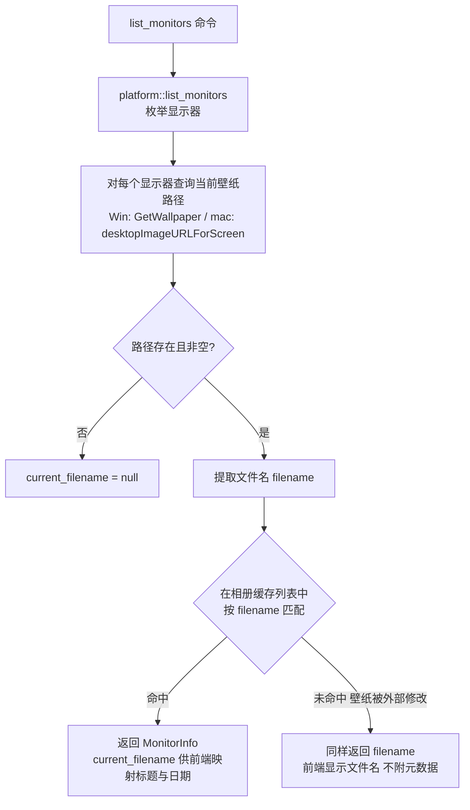

前端的元数据映射：`filename` → 相册条目 `filename` 相等匹配（数据源为现有 `get_bing_wallpaper_list` 缓存或页面已加载列表），得到 title/startdate 用于设置页与选择器展示；未命中时仅显示文件名。

**缓存清理与引用保护**：现有 `clean_cache` 按 mtime 无差别清理缓存图片；逐屏模式下某屏可能长期引用较早的收藏图片，删除源文件在 macOS 上存在重启后壁纸丢失的风险。策略：`clean_cache` 清理前经 platform 反查所有屏幕当前引用的文件集合并跳过（Phase 1 落地，随 `list_monitors` 反查能力顺带实现）。

### 4.3 核心数据结构

**Rust 侧**（见 3.1 骨架）。

**事件 v2**（`events.rs`，serde default 保证旧字段兼容）：

```rust
#[derive(Debug, Clone, Serialize, Deserialize)]
pub struct WallpaperEvent {
  pub title: String,
  pub copyright: String,
  pub url: String,
  pub startdate: String,
  #[serde(default)]
  #[serde(skip_serializing_if = "Option::is_none")]
  pub monitor_id: Option<String>,    // None = 所有屏幕
}
```

**TypeScript 侧**：

```ts
export type WallpaperMode = "all" | "per_monitor";
export type MonitorInfo = {
  id: string; name: string; index: number;
  width: number; height: number; is_primary: boolean;
  current_filename: string | null;
};
export type MonitorSnapshot = { per_monitor: boolean; monitors: MonitorInfo[] };
export type UserConfig = { /* 现有字段 */ wallpaper_mode: WallpaperMode };
```

---

## 5. 接口设计

### 5.1 Tauri 命令

| 命令 | 签名 | 阶段 | 说明 |
|------|------|------|------|
| `set_as_desktop` | `(url, service, monitor_id: Option<String>)` | P1 扩展 | `None` = 所有屏幕（现行为）；`Some(id)` = 指定屏幕；Linux 收到 `Some` 返回错误 |
| `list_monitors` | `() -> MonitorSnapshot` | P1 新增 | 能力位 + 屏幕列表 + 每屏当前壁纸反查，单次 IPC |
| `set_wallpaper_mode` | `(mode: WallpaperMode) -> UserConfig` | P3 新增 | 落 `wallpaper_mode` 配置 |
| 其余现有命令 | 不变 | — | 下载、收藏、设置等均不动 |

`set_as_desktop` 的处理流程见 6.8 决策流程图；`service` 参数（`PhotoService`）保留，platform 层与图片来源解耦。

### 5.2 前端 client 扩展（`shared/tauri/client.ts`）

```ts
wallpapers: {
  // 现有
  setAsDesktop: (url: string, monitorId?: string) =>
    invoke<string>("set_as_desktop", { service: "Bing", url, monitorId: monitorId ?? null }),
  // 新增
  listMonitors: () => invoke<MonitorSnapshot>("list_monitors"),
},
settings: {
  setWallpaperMode: (mode: WallpaperMode) => invoke<UserConfig>("set_wallpaper_mode", { mode }),
}
```

### 5.3 事件协议

`wallpaper:changed` 载荷增加可选 `monitor_id`（见 4.3）。发射点共 4 处，全部需随 Phase 1 透传屏幕参数：

| 发射点 | monitor_id 取值 |
|--------|----------------|
| `cmd.rs` 手动设置 | 与命令参数一致（None 或具体 id） |
| `rotation_thread.rs` | 统一模式 None；逐屏模式为当前推进的屏幕 id |
| `daily_update_thread.rs` | 恒为 None（每日更新固定全屏，见 6.6） |
| `scheduler.rs` 托盘上/下一张 | 跟随 `wallpaper_mode`（统一 None；逐屏为各屏 id） |

`scheduler.rs` 的 `emit_wallpaper_event_by_url` / `emit_wallpaper_event` 需增加屏幕参数透传。

前端现状**未消费**该事件（`useTauriEvents.ts` 不监听）；Phase 2 可选增加监听以在托盘/轮播动作后刷新界面提示，属增强项不阻塞。

### 5.4 错误处理约定

| 层 | 约定 |
|----|------|
| platform | `String` 错误，`[win]/[mac]/[linux]` 前缀；`log::error!` 记录；不 panic |
| cmd | 原样透传 `Result<_, String>`；屏幕 id 校验失败返回 `"显示器不存在或已断开"` |
| rotation / daily | 失败仅记日志，跳过本轮（维持现有 `continue` 语义） |
| 前端 | toast 文案区分：设置失败 / 该系统不支持逐屏 / 显示器已断开 |

---

## 6. 核心流程与时序图

### 6.1 设置壁纸入口总览

| # | 入口 | 触发 | 代码位置 | 目标屏幕（改造后） |
|---|------|------|---------|--------------------|
| 1 | 手动·设为桌面 | 页面按钮/菜单 | `TodayPage.tsx:97`、`HistoryPage.tsx:63`、`FavoritesPage.tsx:46` → `cmd::set_as_desktop` | 所有屏幕（直点）/ 指定屏幕（菜单） |
| 2 | 托盘·上一张/下一张 | 托盘菜单 | `tray.rs` → `AsyncProcessMessage::Previous/NextPhoto` → `background.rs` → `scheduler.rs:98-136` | 跟随 `wallpaper_mode` |
| 3 | 自动轮播 | interval tick | `rotation_thread.rs:32` | 跟随 `wallpaper_mode` |
| 4 | 每日更新 | daily tick | `daily_update_thread.rs:33` | **恒为所有屏幕**（"换到今日壁纸"是全局语义，见 6.6） |

### 6.2 时序图：手动设置 · 所有屏幕（Phase 0 后即为此路径）

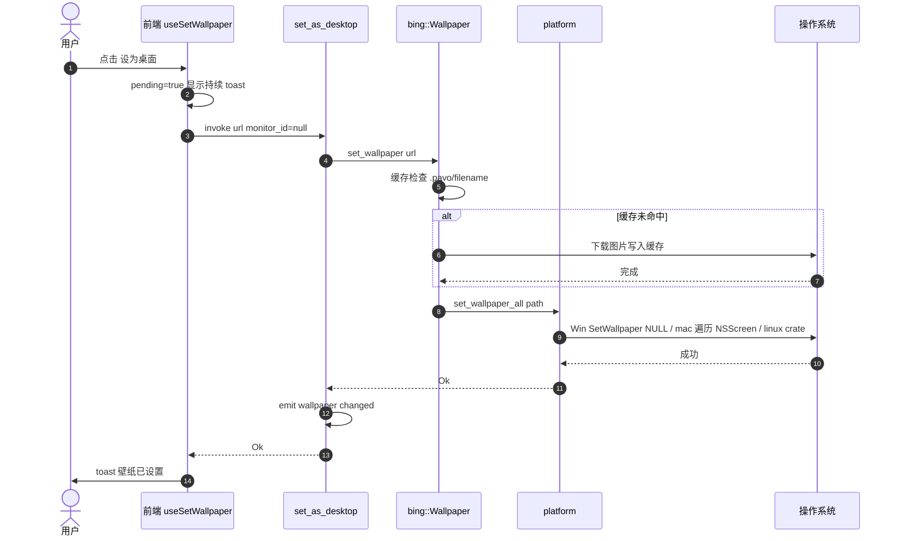

### 6.3 时序图：手动设置 · 指定屏幕（Phase 1/2）

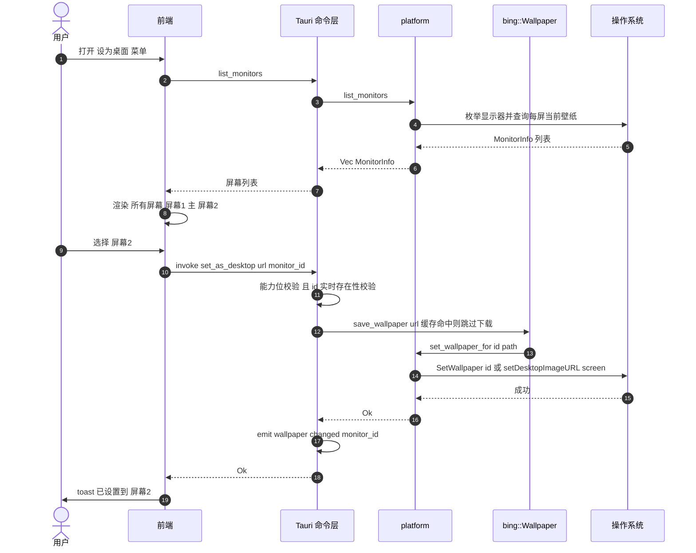

### 6.4 时序图：托盘 · 上一张/下一张

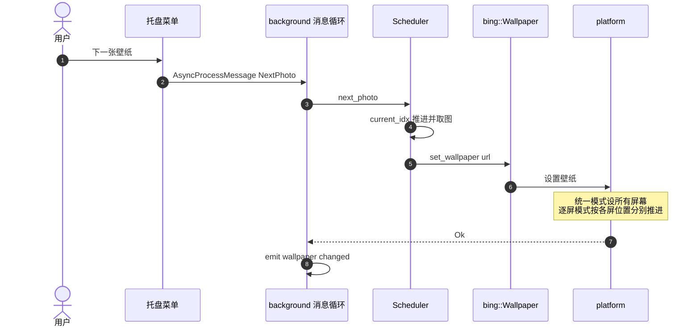

### 6.5 时序图：自动轮播（统一 / 逐屏两种模式）

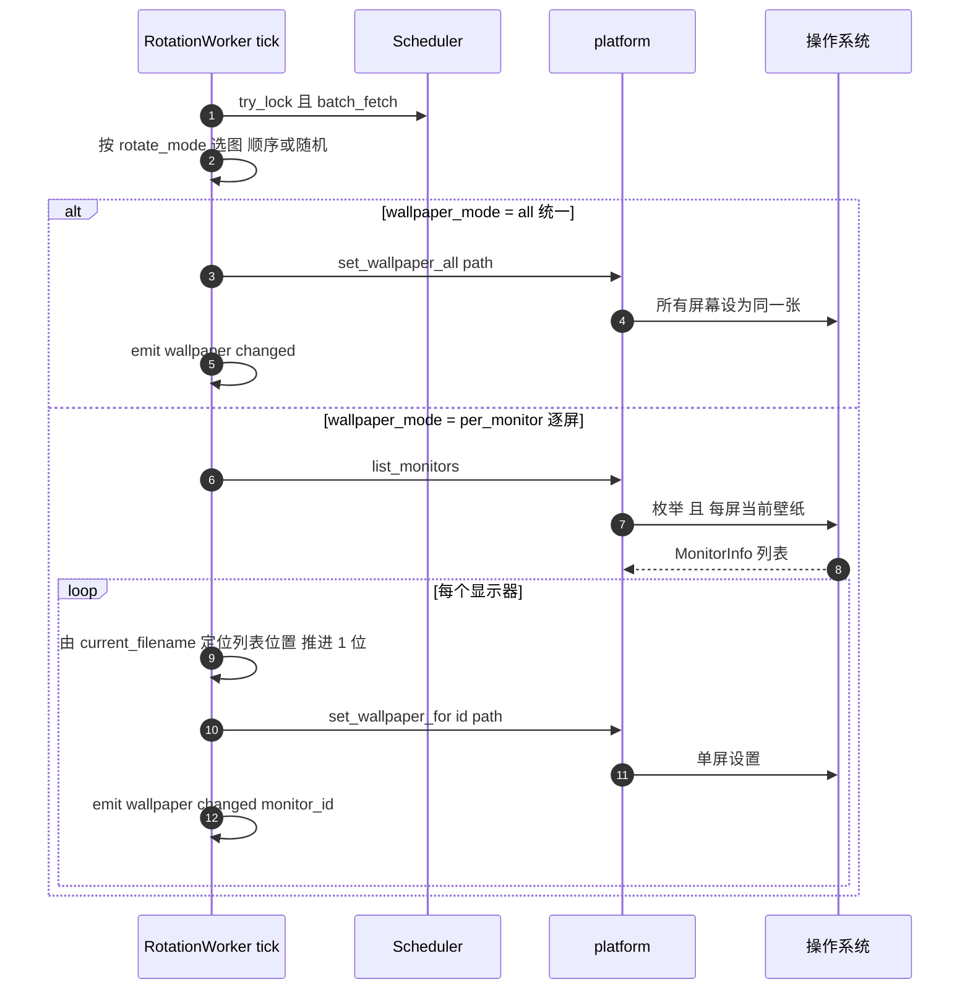

逐屏推进算法详见第 8.2 节。

### 6.6 时序图：每日更新

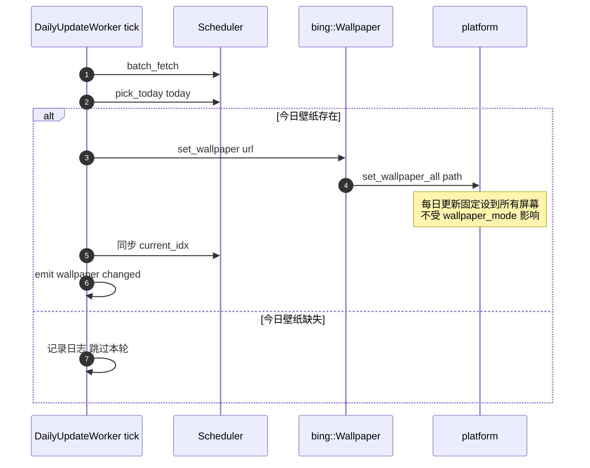

### 6.7 时序图：设置页 / 屏幕选择器加载屏幕状态

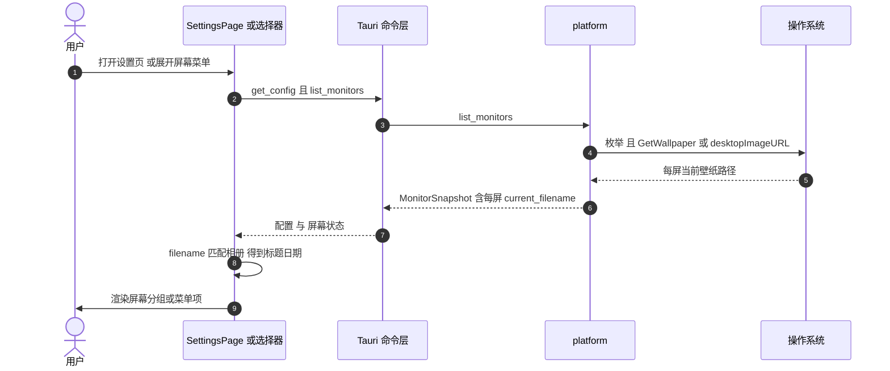

### 6.8 流程图：设置壁纸总体决策（含失败降级）

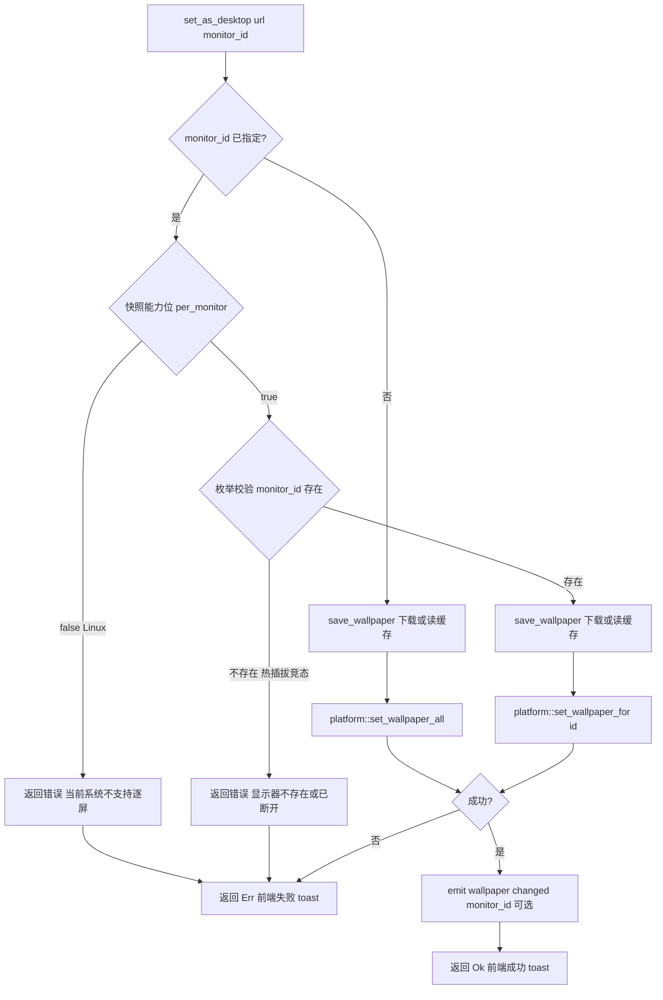

### 6.9 流程图：屏幕热插拔处理

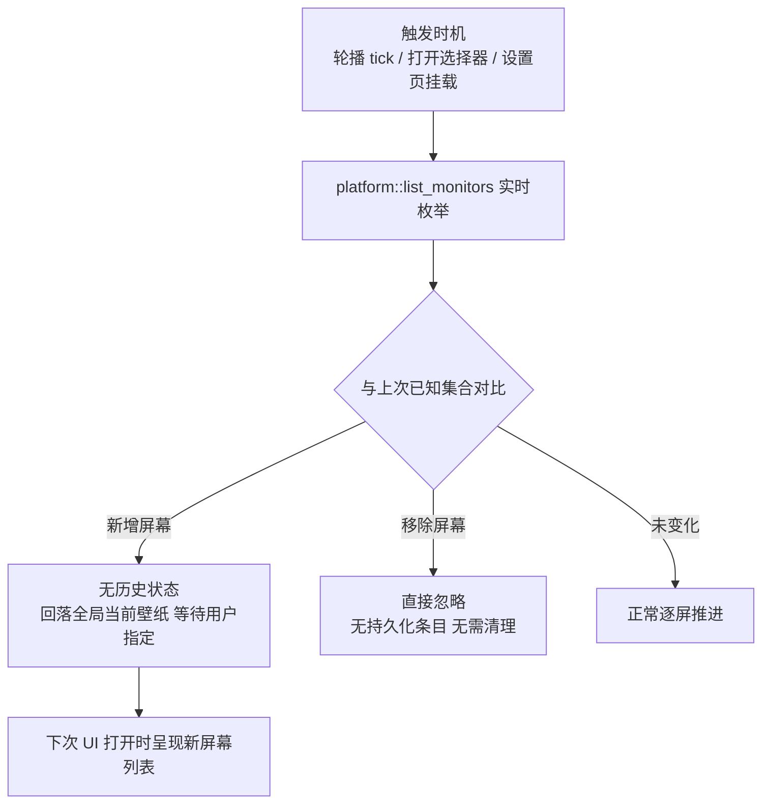

> 设计依据：每屏状态不做持久化（决策 D4），任何屏幕集合变化都通过"实时枚举 + 派生"天然消化，不存在陈旧配置清理问题。

### 6.10 状态图：`wallpaper_mode` 切换语义

```mermaid
stateDiagram-v2
    direction LR
    state "all 统一模式" as All
    state "per_monitor 逐屏模式" as PM
    [*] --> All
    All --> PM : 设置页切换为逐屏
    PM --> All : 设置页切换为统一
    note bottom of All
      切换自下一次轮播 tick 起生效
      不立即重写当前各屏壁纸
      手动设置的目标选择不受模式影响
    end note
```

语义细化：

| 行为 | all 模式 | per_monitor 模式 |
|------|----------|------------------|
| 手动直点"设为桌面" | 所有屏幕 | 所有屏幕（不变，菜单仍可选单屏） |
| 卡片菜单逐屏设置 | 可用 | 可用 |
| 自动轮播 | 所有屏幕同步换 | 每屏独立推进 |
| 托盘上/下一张 | 所有屏幕同步 | 每屏独立推进 |
| 每日更新 | 所有屏幕 | 所有屏幕（固定） |

---

## 7. 前端设计

### 7.1 交互设计

**原则**：直点"设为桌面"保持"所有屏幕"的现有肌肉记忆；逐屏作为菜单内的进阶选项（渐进披露）；能力不足（Linux）时隐藏逐屏入口而非报错；**单屏环境**同样不显示屏幕子菜单（"所有屏幕"与该屏目标等价，避免困惑）。

**① 内容页卡片（History / Favorites，现有 `⋯` 菜单扩展）：**

```
⋯ 菜单
├─ 设为桌面            ← 直选即"所有屏幕"
├─ 设为桌面 ▸          ← 子菜单（per_monitor 能力时显示）
│   ├─ 所有屏幕
│   ├─ 屏幕 1 · 主 · DELL U2723QE
│   └─ 屏幕 2 · LG 27GP850
├─ 收藏
├─ 下载原图
└─ 在 Bing 中查看
```

> 实现取舍：若现有 `Menu` 组件不支持二级子菜单，则以"设为桌面"与"设为指定屏幕…"两个菜单项替代——后者打开一个小型屏幕选择弹层（复用 tooltip/popover 样式语言）。Phase 2 开工时按组件现状二选一，优先子菜单。

**② TodayPage 主操作区（现有主按钮扩展）：**

```
[ 设为桌面 ] [ ▾ ]   ← 主按钮直点 = 所有屏幕；▾ 打开屏幕菜单
[ 收藏 ] [ 下载 ] [ 在 Bing 中查看 ]
```

**③ 设置页新增"屏幕"分组（Phase 2 展示、Phase 3 增加模式开关）：**

```
屏幕
┌────────────────────────────────────────────┐
│ 壁纸模式      ( ) 统一壁纸   ( ) 按屏幕独立   │   ← Phase 3
├────────────────────────────────────────────┤
│ 屏幕 1 · 主 · DELL U2723QE · 2560x1440      │
│ 当前：山湖晨雾 · 2026-11-14                  │
├────────────────────────────────────────────┤
│ 屏幕 2 · LG 27GP850 · 1920x1080             │
│ 当前：未由 Pavo 设置                         │
└────────────────────────────────────────────┘
```

- 当前壁纸条目由 `list_monitors` 的 `current_filename` 经相册映射得到（4.2）；外部修改过（未命中）时显示文件名；
- Linux（`per_monitor=false`）：不渲染该分组或渲染为提示"当前系统仅支持统一壁纸"。

### 7.2 Hook 与状态改造

```ts
// features/set-wallpaper/model/useSetWallpaper.ts
export function useSetWallpaper() {
  // pending 逻辑不变
  const setWallpaper = async (url: string, monitorId?: string) => { ... };
  // 成功文案: monitorId ? `已设置到 ${monitorName}` : "壁纸已设置"
}

// features/monitor/model/useMonitors.ts（新增）
export function useMonitors() {
  // 惰性加载: 菜单展开/设置页挂载时拉取 list_monitors 快照
  // 返回 { per_monitor, monitors, loading, reload }
}
```

加载时机刻意选择**菜单展开/页面挂载时**（而非应用启动时）：屏幕热插拔后无需订阅系统通知，打开即枚举即为最新（见 6.9）。

### 7.3 反馈文案

| 场景 | 文案 |
|------|------|
| 设置中 | 正在设置壁纸…（现有持续 toast） |
| 成功·所有屏幕 | 壁纸已设置 |
| 成功·指定屏幕 | 已设置到「屏幕 2 · LG 27GP850」 |
| 失败 | 设置失败，请重试 |
| 屏幕已断开 | 显示器不存在或已断开，请重新选择 |
| 系统不支持 | 当前系统不支持按屏幕设置 |

### 7.4 前端改动清单

| 文件 | 改动 |
|------|------|
| `shared/tauri/client.ts` / `types.ts` | 新增 `listMonitors`（P1）与 `setWallpaperMode`（P3）两个调用及对应类型；`setAsDesktop` 加参 |
| `entities/settings/model/types.ts` | `UserConfig` 增 `wallpaper_mode`（P3） |
| `features/set-wallpaper/model/useSetWallpaper.ts` | 目标屏参数 + 文案 |
| `features/monitor/model/useMonitors.ts` | 新增 |
| `pages/today/TodayPage.tsx` | 主按钮 + 屏幕菜单 |
| `pages/history/HistoryPage.tsx` / `pages/favorites/FavoritesPage.tsx` | `⋯` 菜单扩展 |
| `pages/settings/SettingsPage.tsx` | 屏幕分组（P2 展示 / P3 开关） |
| `app/useTauriEvents.ts` | （可选）监听 `wallpaper:changed` 刷新提示 |

---

## 8. 轮播线程改造

### 8.1 统一模式（`wallpaper_mode = "all"`，默认）

与现行为完全一致：tick → `batch_fetch` → 按 `rotate_mode`（顺序/随机）选图 → `set_wallpaper_all` → emit。Phase 0 后自动经由新平台层。

### 8.2 逐屏独立模式（`wallpaper_mode = "per_monitor"`）

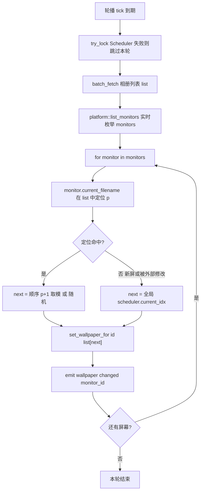

要点：

- **共享实现**：逐屏推进逻辑抽取为单一函数（如 `scheduler::advance_per_monitor`），`rotation_thread` 与托盘路径（`scheduler.next_photo/previous_photo`）复用，避免两处实现漂移；统一模式路径保持现状；
- **模式读取**：worker 启动时从配置读取 `wallpaper_mode`（与现有 `rotate_interval_minutes` / `rotate_mode` 的启动读取一致）；运行中变更经消息重启 worker（见 10.4）；
- **推进锚点**：以"该屏当前壁纸文件名在相册列表中的位置"为基准推进（而非枚举序号偏移——枚举顺序随插拔变化，不可靠）；
- **缺失态回落**：新屏 / 文件名无法定位 → 从全局 `current_idx` 开始；逐屏模式下 `current_idx` 每 tick 仍整体推进，保持回落锚点新鲜；同起点的屏幕将保持同步推进，属可接受行为；
- **随机模式**：每屏每 tick 各自随机，无锚点问题；
- **锁纪律**：沿用现有 `try_lock` 失败跳过语义，避免与手动设置/托盘操作互斥等待；锁内执行下载/设置沿现有模式，多屏放大持有时长，但缓存命中后近零，可接受；
- 相册列表为全局一份（各屏共享同一图池），不做每屏列表。

---

## 9. 分阶段实施计划

### 9.1 Phase 0 · 平台层替换（行为保持）

**范围**：仅替换"应用到系统"层；命令签名、事件、调度、UI 全部不动（macOS 主线程调度所需的 AppHandle 经全局句柄注入获取，不改变函数签名——与 `tray.rs` 的 `TRAY_RECT_CACHE` 全局缓存惯例一致，见 3.3）。

| 文件 | 改动 |
|------|------|
| `src-tauri/src/platform.rs` | 新增：`set_wallpaper_all` + `set_app_handle`；Win = IDesktopWallpaper `SetWallpaper(NULL)` + `SetPosition(FILL)`；mac = 经全局句柄 `run_on_main_thread` 遍历 NSScreen；linux = 委托 crate（`set_from_path` + `set_mode(Crop)` 两步都保留，维持现有填充行为） |
| `src-tauri/src/services/bing.rs` | `set_wallpaper_from_local`（143-156 行）函数体改为调用 `platform::set_wallpaper_all`，删除 `wallpaper::set_from_path/set_mode` 调用与 `cfg!(not(macos))` 分支 |
| `src-tauri/Cargo.toml` | `wallpaper` 移入 `[target.'cfg(target_os = "linux")'.dependencies]` 并去掉 `from_url`；新增 windows / objc2 系列 target 依赖；顺带移除未使用的 `indicatif`（经核实源码零引用） |
| `src-tauri/src/main.rs` | `mod platform;` + setup 中 `platform::set_app_handle(app.handle().clone())` |

**验收标准**：

1. Windows 多屏（含 125% + 100% 缩放混排）：设为桌面后**所有屏幕**显示同一张图，填充模式与旧版视觉一致；
2. macOS 内置屏 + 外接屏：同上；设置耗时相对 osascript 版本明显下降；无权限弹窗；
3. 单屏设备行为不变；`cargo test` / `cargo check` / `pnpm test` / `pnpm typecheck` 全绿；
4. Linux：`cargo check` 通过（CI 矩阵验证），运行行为依赖 crate 不变。说明：开发机为 Windows，Linux 运行时行为无法本地验证，保障手段是依赖声明仅移动（不改调用逻辑）+ CI 编译；
5. Phase 0 以 patch 版本独立发版（`pnpm release`），回归窗口最小化。

### 9.2 Phase 1 · 屏幕枚举与逐屏定向

| 文件 | 改动 |
|------|------|
| `platform.rs` | `list_monitors` 快照（内含每屏反查辅助）/ `set_wallpaper_for` |
| `services/bing.rs` | `clean_cache` 增加引用保护：跳过当前被任一屏幕引用的壁纸文件（引用集合来自 `list_monitors` 反查），见 4.2 |
| `cmd.rs` | 新命令 `list_monitors`；`set_as_desktop` 加 `monitor_id: Option<String>` 与校验 |
| `scheduler.rs` | `emit_wallpaper_event_by_url` / `emit_wallpaper_event` 增加屏幕参数透传（托盘路径） |
| `events.rs` + 4 个发射点 | `WallpaperEvent` v2，透传屏幕参数 |
| `main.rs` | 注册新命令 |

### 9.3 Phase 2 · 前端逐屏交互

按 7.1–7.4 落地：三页菜单、Today 主按钮、设置页"屏幕"分组（仅展示）、`useMonitors`、toast 文案；同步更新受影响的既有测试（三页菜单结构与设置页断言）。

### 9.4 Phase 3 · 轮播逐屏独立

`config.rs`（`WallpaperMode` + 容错解析 + 测试）→ `cmd::set_wallpaper_mode` → 设置页模式开关 → `rotation_thread.rs` / `scheduler.rs` 逐屏分支（8.2）。

文件级清单：`config.rs`、`cmd.rs`、`services/mod.rs`（`AsyncProcessMessage` 扩展载荷或新增消息）、`background.rs`（处理模式切换消息、重启轮播 worker）、`rotation_thread.rs`、`scheduler.rs`（共享推进函数 + 事件透传）、设置页模式开关。

### 9.5 阶段顺序与依赖

四个阶段为线性演进，但相互独立、可单独发版回滚：

- Phase 0 是 Phase 1/3 的地基（平台层）；
- Phase 1 是 Phase 2/3 的接口前提（命令与事件）；
- Phase 2（前端交互）与 Phase 3（轮播逐屏）互不依赖，可并行或按优先级调整顺序。

### 9.6 依赖变更清单

```toml
# 移除顶层
# wallpaper = { version = "3.2.0", features = ["from_url"] }

[target.'cfg(target_os = "windows")'.dependencies]
windows = { version = "0.58", features = [
  "Win32_UI_Shell", "Win32_System_Com", "Win32_Graphics_Gdi",
] }

[target.'cfg(target_os = "macos")'.dependencies]
objc2 = "0.6"
objc2-foundation = "0.3"
objc2-app-kit = { version = "0.3", features = ["NSScreen", "NSWorkspace"] }

[target.'cfg(target_os = "linux")'.dependencies]
wallpaper = "3.2"
```

（依赖版本以 crates.io 实际发布为准，此处为占位；objc2 各 crate 的具体 feature 列表以实际编译为准。`Win32_Graphics_Gdi` 自 Phase 1 屏幕枚举起才需要，Phase 0 仅前两项。）

### 9.7 风险与回滚

| 风险 | 影响 | 缓解 |
|------|------|------|
| Windows COM 调用线程模型出错（RPC_E_CHANGED_MODE 等） | 设置失败 | 按 3.2.1 处理错误码；Phase 0 验收覆盖多屏场景 |
| macOS 主线程调度死锁（run_on_main_thread 时主线程阻塞） | 设置挂起 | platform 调用均在 spawn_blocking 工作线程发起，不占用主线程；channel 加超时 |
| 屏幕 id 变化（Win 换接口 / mac 重启） | 仅影响已打开的选择器 | 命令层实时校验，报错后重开即恢复；无持久化状态受影响 |
| 视觉差异（macOS 缩放选项 / Windows FILL 与旧 Crop 差异） | 壁纸显示模式变化 | Phase 0 验收清单显式比对；不一致时调整对应选项 |
| Linux 回归 | Linux 用户不可用 | crate 仅降级为 target 依赖，调用路径不变；CI 矩阵保障编译 |
| 回滚 | — | 各 Phase 独立提交/发版；Phase 0 回滚 = revert 单个 PR，恢复 crate 全平台引用 |

### 9.8 流程约束（项目既有约定）

- 每阶段开工前取得用户确认；阶段完成自审、验证、提交；
- 提交信息中文、不含 AI 措辞；
- 合并/发布前执行完整验证：`pnpm test`、`pnpm typecheck`、`pnpm build`、`cd src-tauri && cargo test && cargo check`、`pnpm tauri dev` 双平台冒烟。

---

## 10. 测试与验收

### 10.1 Rust 单元测试

| 模块 | 用例 |
|------|------|
| `config.rs` | `wallpaper_mode` 序列化/反序列化；`parse_tolerant` 缺字段→all、非法值→all、合法值保留 |
| 派生映射 | filename → 相册条目命中与未命中两分支 |
| 逐屏推进 | 8.2 算法：正常推进 / 缺失态回落 / 列表环绕取模 |

### 10.2 前端测试

| 用例 | 断言 |
|------|------|
| `useSetWallpaper` | 带/不带 monitorId 的调用参数与成功文案 |
| 菜单扩展 | `per_monitor=false` 时不渲染屏幕子菜单 |
| 设置页屏幕分组 | `current_filename` 命中显示标题、未命中显示文件名 |

### 10.3 手动验收清单（分平台）

**Windows（多屏实机）**
- [ ] 单屏：设为桌面 / 托盘上下张 / 轮播 / 每日更新
- [ ] 双屏同分辨率：逐屏设置 A→屏1、B→屏2；重启后各自保留（OS 行为验证）
- [ ] 双屏缩放混排（125% + 100%）：设置后填充正确
- [ ] 拔掉屏2 → 轮播下一 tick 不报错、不遗漏屏1
- [ ] 屏2 重插到**另一个接口** → 选择器即时显示、可正常设置

**macOS（内置 + 外接）**
- [ ] 内置屏与外接屏逐屏设置
- [ ] 外接屏重启后逐屏轮播仍能推进（从 OS 反查的当前文件名重新锚定）
- [ ] 无 TCC 权限弹窗；设置耗时无子进程延迟
- [ ] 合盖-唤醒后枚举正确

**Linux（CI 构建可运行即可）**
- [ ] 全局设置路径不回归（crate 行为）
- [ ] 前端逐屏入口隐藏

### 10.4 边界用例矩阵

| 用例 | 预期 |
|------|------|
| 选择器打开后屏幕被拔出，再点击该项 | 命令层校验失败 → "显示器不存在或已断开" |
| 两张屏设同一张图 | 只下载一次（缓存按文件名去重） |
| 下载失败中途 | 设置失败 toast，现有缓存不动 |
| 逐屏模式下次序轮播至列表末尾 | 取模环绕 |
| 相册列表刷新后文件名仍可定位 | 列表包含近 7/14 天与今日，足够覆盖 |
| `wallpaper_mode` 在轮播运行中切换 | `set_wallpaper_mode` 在轮播激活时经消息队列重启 worker（扩展 `UpdateRotationConfig` 载荷或新增消息），间隔计时随重启重置，与现有间隔变更行为一致 |
| 用户在系统设置里手动改了某屏壁纸 | 下次反查显示新文件名，未命中元数据时仅显示文件名 |
| 缓存文件到保留期但仍被某屏引用 | `clean_cache` 跳过该文件，待不再引用后的下一轮清理 |

---

## 11. 附录

### 11.1 平台 API 参考

- Windows `IDesktopWallpaper`：Microsoft Learn — shell/desktopwallpaper（CLSID_DesktopWallpaper）
- `SystemParametersInfoW / SPI_SETDESKWALLPAPER`（旧机制，Phase 0 后不再使用）
- Apple `NSWorkspace`：`setDesktopImageURL:forScreen:options:error:`、`desktopImageURLForScreen:`
- Apple `NSScreen`：`screens`、`deviceDescription`
- `wallpaper` crate v3.2.0 源码（Linux 路径保留依据）

### 11.2 术语表

| 术语 | 含义 |
|------|------|
| monitor_id | 屏幕运行时标识（Win 设备路径 / mac CGDisplayID），会话内回传有效 |
| current_filename | OS 反查的某屏当前壁纸文件名 |
| 统一模式 / 逐屏模式 | `wallpaper_mode = all / per_monitor` |
| 派生状态 | 不持久化、运行时从 OS 与相册列表推导的每屏壁纸状态（4.2） |
| 运行时标识 | `MonitorInfo.id` 仅在本次枚举内有效，无跨重启匹配需求（3.5） |

### 11.3 方案自审记录（决策溯源）

本方案经历两轮自审，以下修正已体现在最终设计中：

1. **Linux 缺口（严重）**：初版 Phase 0 直接移除 crate 会导致 Linux（CI 实际发布）失去设置能力 → 修正为 crate 降级为 Linux-only 依赖（D1）；
2. **重复状态（过度设计）**：初版设计了 `[[monitor_wallpapers]]` 持久化表 → OS 已持久化每屏壁纸，改为运行时反查（D4），配置只加 `wallpaper_mode`；
3. **模块结构（过度设计）**：初版预设 `platform/` 目录四文件 → 改为单文件起步，超 400 行再拆；
4. **能力标志位置**：`supports_per_monitor` 是系统级能力，初版从 `MonitorInfo` 字段改为独立查询接口，v1.1 进一步并入 `list_monitors` 快照能力位（`per_monitor`），不再单独成命令；
5. **措辞修正**："行为保持"限定为"用户可见行为保持"（Windows SPI 在各屏已有不同壁纸时仅改主屏，新实现显式全屏设置更确定；macOS 缩放选项显式化，验收比对）；
6. **Windows id 稳定性**：设备路径实例段换接口/驱动后会变 → 初版为此设计了"回落匹配"，第二轮评审发现 D4（状态不持久化）落地后该机制已无消费者，改为"运行时实时枚举 + 命令层校验"，匹配逻辑连同 macOS 稳定键一并移除；
7. **轮播方案 B 公式修正**：`list[(idx+i)%len]` 依赖不稳定的枚举顺序 → 改为按每屏当前文件名定位推进（8.2）。

**第二轮评审补充修正（v1.1）：**

8. **错误修正**：`rename_all = "lowercase"` 会错误产出 `"permonitor"`，改为 `snake_case`；依赖清单中不存在独立的 workspace crate（NSWorkspace 由 `objc2-app-kit` 提供）；`EnumDisplayDevicesW` 位于 `Win32_Graphics_Gdi` 而非 `Win32_Devices_Display`；
9. **过度设计削减**：能力查询并入 `list_monitors` 快照（省一个命令与一次 IPC）；事件删除无人消费的 `monitor_name` 字段；删除 D4 落地后无消费者的 id 回落匹配与 macOS 稳定键；
10. **遗漏补充**：逐屏推进明确为 rotation 与托盘共享函数；逐屏模式下 `current_idx` 保持推进；`wallpaper_mode` 运行中切换经消息重启 worker；元数据映射数据源明确为相册缓存；
11. 按评审意见移除甘特图，改为阶段依赖说明（排期属项目管理信息，不属于技术方案）。

**第三轮评审补充修正（v1.2）：**

12. **功能遗漏**：发现 `clean_cache`（按 mtime 无差别清理）与逐屏引用存在冲突——某屏长期引用较早收藏图片时，源文件被清理后 macOS 有重启丢壁纸风险 → 增加引用保护策略（4.2、9.2、10.4）；
13. **术语残留**：能力矩阵仍用旧字段名 `supports_per_monitor` → 统一为快照能力位 `per_monitor`；自审记录第 4 条与最终设计矛盾（仍写"独立查询接口"）→ 更正为快照能力位；
14. **补充**：worker 启动时读取 `wallpaper_mode` 的时机（8.2）；顺带清理零引用依赖 `indicatif`（9.1）。

**第四轮评审补充修正（开发计划专项，v1.3）：**

15. **矛盾修复**：Phase 0 声称"调用方零改动"，但 macOS 主线程调度需要 AppHandle 而 `bing::Wallpaper::set_wallpaper` 无该参数 → 采用 setup 注入的全局 `OnceLock<AppHandle>`（`platform::set_app_handle`，与 tray.rs 全局缓存惯例一致），签名保持不变；
16. **错误修复**：Phase 0 的 Linux 分支原描述"委托 crate"遗漏 `set_mode(Crop)`，会导致填充行为回归 → 明确 linux 分支保留 `set_from_path + set_mode(Crop)` 两步；
17. **遗漏补充**：Phase 3 文件清单补 `services/mod.rs` 与 `background.rs`（模式切换消息与 worker 重启）；Phase 1 文件清单补 `scheduler.rs`（emit 透传屏幕参数）；Phase 2 补"更新受影响的既有前端测试"；Phase 0 补 patch 独立发版策略与 Linux 验证局限说明。
